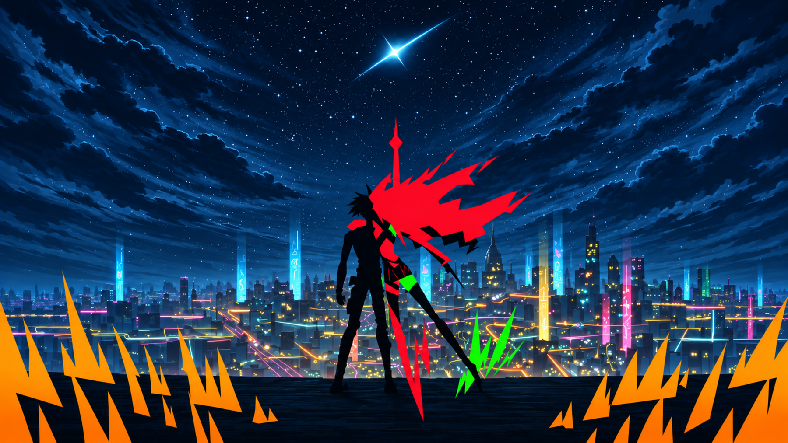

# CAPRICORN

An Omarchy theme for Capri — the memory engram construct of Cyberpunk: Edgerunners 2.

Deep night navy pulled straight from the Capri artwork, with neon green,
arterial red, and hot orange running through every surface. The terminal
blooms green like the Capri's optics; alerts run red like arterial spray;
everything hot runs amber.



## Install

```bash
omarchy theme install <your-git-remote-url>
```

or, for a local copy:

```bash
cp -r ~/Projects/themes/capricorn ~/.config/omakub/themes/capricorn
omarchy theme set capricorn
```

## Notes

- **Accent**: GNOME accent color is set to `green`, with `Yaru-red` folder
  icons — green chrome, red folders, like Capri's jacket over chrome.
- **Unlock screen**: `unlock.png` is a breach-protocol console (hex matrix,
  required sequences, buffer, trace timer) so the boot/login password screen
  reads like an ICE hack. Rebuild it with `tools/generate-unlock.sh`.
- **Login / boot art**: run `omarchy gdm set-by-theme capricorn` and
  `omarchy plymouth set-by-theme capricorn` (both need sudo) to carry the
  lock-screen logo into GDM and Plymouth.
- **Palette**: see `colors.toml`; the semantic keys feed terminal, btop,
  Chromium, Walker, Obsidian, Vencord, and the GNOME extensions.
- Backgrounds live in `backgrounds/`; cycle them with
  `omarchy theme bg next`.
